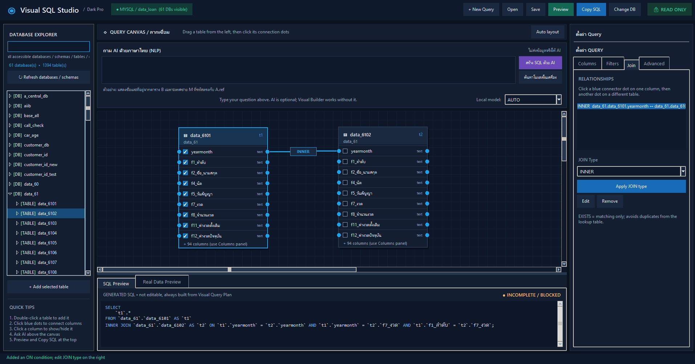

# SQL Generated

**โปรแกรม Windows สำหรับช่วยสร้าง SQL ด้วยภาษาไทย (Local AI) และการลากเชื่อมตาราง (Visual Query Builder)** โดยเน้นการอ่านข้อมูลอย่างเดียว ไม่อนุญาตให้แก้ไขข้อมูลต้นฉบับผ่านระบบ และไม่ส่งข้อมูลลูกค้าจริงเข้า AI

## 1. โปรแกรมนี้ทำอะไรได้

- เชื่อมต่อ MySQL, Microsoft SQL Server หรือ PostgreSQL เพื่ออ่าน **Schema → Table → Column**
- ลาก/เพิ่มตารางลง Canvas แล้วย้ายตำแหน่งได้; คลิกจุดวงกลมที่คอลัมน์ 2 ฝั่งเพื่อสร้าง `INNER`, `LEFT`, `RIGHT` หรือ `EXISTS` relationship
- เลือกคอลัมน์ที่จะนำมาแสดง, เพิ่ม `WHERE`, `AND` / `OR`, `DISTINCT`, aggregate (`COUNT`, `COUNT_DISTINCT`, `SUM`, `AVG`, `MIN`, `MAX`), `GROUP BY` และ `ORDER BY` ผ่านหน้าจอ
- ใช้ภาษาไทยสั่ง **Local AI** ให้เสนอ Query Plan หรือปรับ Query เดิม (ต้องติดตั้ง Ollama และโมเดลในเครื่องแยกต่างหาก)
- ตรวจ SQL ที่สร้างทั้งชุด; **ไม่มีช่องให้รัน SQL ดิบที่เขียนเอง** และ AI ไม่สามารถส่ง SQL ดิบให้ Database ประมวลผลโดยตรง
- Preview ผลลัพธ์จริง 100 แถวผ่านบัญชีอ่านอย่างเดียว *เมื่อผู้ใช้กด Refresh*; ไม่ส่งผลลัพธ์เข้า AI
- ดู SQL ที่สร้าง, กด **Copy SQL** หรือ **Save/Open Workspace** (`.vsql`)
- **New Query** แยกบริบท AI, JOIN, Filter และคอลัมน์ของแต่ละงานออกจากกัน
- โปรแกรมหลักใช้ Tkinter ซึ่งมากับ Python; AI จะถูกเรียกเมื่อกดใช้งานเท่านั้น เครื่องสเปกต่ำยังใช้ Visual Builder ได้

## ตัวอย่างหน้าจอ


## 2. ข้อกำหนดและสิ่งที่ต้องติดตั้ง

| รายการ | ต้องมีหรือไม่ | หมายเหตุ |
|---|---|---|
| Windows 10/11 | ต้องมี | Windows เป็นแพลตฟอร์มเป้าหมาย |
| Python 3.11 ขึ้นไป | ต้องมีสำหรับรันจาก Source | ติดตั้ง Python พร้อม `py` launcher |
| Ollama | **ไม่บังคับ** | ต้องการเฉพาะ AI ภาษาไทยบนเครื่อง |
| โมเดล Local | **ไม่บังคับ** | เลือกโมเดลขนาดเล็กให้เหมาะกับ RAM; ไม่มีการดาวน์โหลดอัตโนมัติ |
| sqlglot | Must install | Full-statement AST verification is required for live Preview and Copy SQL |
| PyMySQL | เมื่อใช้ MySQL | ติดตั้งผ่าน `requirements.txt` |
| psycopg2-binary | เมื่อใช้ PostgreSQL | ติดตั้งผ่าน `requirements.txt` |
| pyodbc + Microsoft ODBC Driver 17/18 | เมื่อใช้ SQL Server | ODBC Driver 17 หรือ 18 เป็นโปรแกรมระบบที่ IT ต้องติดตั้งเพิ่มเติม |

**สเปกเครื่อง:** โปรเจกต์ไม่ได้ล็อก CPU/GPU หรือ RAM ตายตัว Visual Builder สามารถทำงานได้โดยไม่เปิดโมเดล ส่วน AI เลือกโมเดลที่ติดตั้งอยู่และขนาดที่เหมาะกับ RAM ว่าง (`AUTO`) หากเครื่องไม่พอจะปฏิเสธการเรียก AI และยังใช้ฟีเจอร์อื่นได้ตามปกติ ไม่สามารถรับรองประสิทธิภาพทุกสเปกโดยยังไม่ทดสอบบนเครื่องจริง

## 3. วิธีติดตั้ง Windows

1. แตกไฟล์ ZIP ลงโฟลเดอร์ที่อนุญาตให้ทำงาน เช่น `Documents\VisualSQLStudio`
2. ติดตั้ง **Python 3.11+** และเลือกให้มี `py` launcher
3. ดับเบิลคลิก `install_windows.bat` (ต้องมีอินเทอร์เน็ตเพื่อดาวน์โหลดไลบรารี Python หรือใช้แหล่งแพ็กเกจที่ IT จัดให้)
4. เมื่อติดตั้งเสร็จ ดับเบิลคลิก `run_windows.bat` เพื่อเปิดโปรแกรมโดยไม่ต้องพิมพ์คำสั่ง
5. หากเปิดแล้วไม่เห็นหน้าต่าง ให้ใช้ `run_debug_windows.bat` และตรวจ `logs\startup_error.log`

### ทำเป็น .exe ด้วยตัวเองบน Windows (ตัวเลือกเสริม)

หลังติดตั้งเรียบร้อย กด `build_exe_windows.bat` เพื่อให้ PyInstaller สร้างไฟล์ใน `dist\VisualSQLStudio\VisualSQLStudio.exe` (**ต้องสร้างบน Windows** และมีอินเทอร์เน็ตสำหรับติดตั้ง PyInstaller) โครงการนี้ส่ง Source + Script ไม่ได้แนบ `.exe` ที่ผ่านการทดสอบบน Windows จริง

## 4. ขั้นตอนใช้งานจากต้นจนจบ

**Simple flow:** Connect form (5 fields) -> Test Connection -> Connect -> Ask AI above the Canvas OR manually drag tables -> Review SQL -> Refresh Real Preview -> Copy SQL / Save Workspace. The app NEVER inserts, updates or deletes records.


### Step A: Connect Database / เชื่อมต่อฐานข้อมูล (no pop-up windows)

1. Open `run_windows.bat` (after installation). The program starts on the connection page, NOT on a demo dataset.
2. Select **MySQL**, **PostgreSQL**, or **SQL Server** in the single database-type dropdown.
3. Fill the five fields **Host, User, Password, Database, Port**. Examples of default ports: MySQL `3306`, PostgreSQL `5432`, SQL Server `1433`. The port changes when you select another engine (you can override it).
4. Click **1. Test Connection / ทดสอบการเชื่อมต่อ**. This opens a short-lived database connection and runs only `SELECT 1`. No tables are loaded or modified.
5. The **2. Connect Database / เชื่อมต่อฐานข้อมูล** button is disabled until the test succeeds. Editing any input afterward requires a fresh test.
6. Click **Connect** to load the accessible **Database / Schema / Table / Column** tree from the same server into the same window. Passwords are never written to workspace files.
7. After connection, click **Change connection / เปลี่ยนฐานข้อมูล** to return to the same-window setup form; **Back to Workspace** keeps the current connection/query.

Important: Test Connection proves only reachability/login, **not** that the account lacks write permissions. Ask IT/DBA to provision and audit a read-only account. Verified TLS is used by default for remote servers; if corporate legacy TLS prevents access, expand Advanced connection options and obtain IT approval before selecting a compatibility mode. SQL Server uses whichever Microsoft ODBC Driver 18 or 17 is installed.

### ขั้นตอน B: แก้คอลัมน์ที่แสดง

1. คลิก Table B บน Canvas
2. ด้านขวาในแท็บ **Columns** ให้เอาเครื่องหมายเลือกออกจาก `id`, `เพศ`, `อายุ` หรือกด **Only name + address**
3. SQL จะเปลี่ยน `SELECT` ให้เหลือ `ชื่อ`, `ที่อยู่` โดยคง JOIN/EXISTS และ Filter เดิม
4. จะเห็นคำเตือนว่าข้อมูล Preview ยังเป็นของ Query เก่า ให้กด **Refresh** เพื่อดึงข้อมูลตาม SQL ใหม่
5. กด **Copy SQL** เพื่อนำ SQL ไปตรวจและรันเองในเครื่องมือฐานข้อมูลอื่นตามนโยบายบริษัท

### ขั้นตอน C: สร้าง Query ใหม่ด้วยตัวเอง

1. กด **+ New Query** — ระบบล้างบริบทของ Query ก่อนหน้าทั้งหมด แต่ยังคง Connection เดิม
2. ดับเบิลคลิก Table ใน Database Explorer ทางซ้ายเพื่อเพิ่มลง Canvas หรือใช้ปุ่ม `+ Add selected table` (รองรับการลากจาก Treeview ไปบน Canvas)
3. คลิกจุดสีฟ้าของคอลัมน์หนึ่ง แล้วคลิกอีกจุดหนึ่งที่ Table อื่น เพื่อเลือกชนิด JOIN
4. คลิก Table แล้วติ๊ก/เอาติ๊กคอลัมน์ที่ต้องการแสดง
5. เพิ่มเงื่อนไขในแท็บ **Filters**; เครื่องมือขั้นสูงอยู่ใน **Advanced**
6. SQL จะแสดงด้านล่าง; หาก Query ยังไม่ครบ โปรแกรมจะยังไม่ให้สถานะผ่าน
7. กด Preview เมื่อพร้อม (อ่านสูงสุด 100 แถวต่อครั้ง) และ Save ถ้าต้องการใช้ต่อในภายหลัง

### ขั้นตอน D: ใช้ AI ภาษาไทย (ทางเลือก)

1. ดาวน์โหลดและติดตั้ง Ollama จากแหล่งที่เชื่อถือได้ตามนโยบาย IT
2. ดาวน์โหลด **โมเดลที่ประมวลผลบนเครื่องจริง** ขนาดเล็กผ่าน Ollama ตามสเปกเครื่อง (ตัวโปรแกรมไม่ดาวน์โหลดให้)
3. เปิด Ollama บนเครื่องให้บริการที่ `127.0.0.1:11434` เท่านั้น
4. After connecting, look for the large **ถาม AI ด้วยภาษาไทย (NLP)** field directly ABOVE the Visual Canvas. Click **ค้นหาโมเดลในเครื่อง** to list installed Ollama models, then choose **AUTO** or a specific local model inline; no separate settings window is needed.
5. Type your Thai NLP question into that large field, e.g. “ตรวจ A.ref กับ B.id เฉพาะเพศชาย M เอาแค่ชื่อกับที่อยู่จาก B”
6. Click **สร้าง SQL ด้วย AI** โปรแกรมจะส่งเฉพาะชื่อ Schema/Table/Column, แผน Query ปัจจุบัน และข้อความที่คุณพิมพ์ ไม่มีผลลัพธ์ฐานข้อมูลจริงหรือรหัสผ่าน
7. AI ตอบกลับเป็น **แผน Query** ไม่ใช่ SQL ดิบ; ระบบตรวจว่าอ้างอิงเฉพาะ Table และ Column ที่มีจริง แล้วถามคุณก่อนปรับ Diagram/SQL
8. ดูผลลัพธ์และปรับต่อได้ เมื่อกด **New Query** บริบทก่อนหน้าจะไม่ถูกนำมาใช้

## 5. โครงสร้างโครงการ

```text
visual_sql_studio/
├─ app.py                     จุดเริ่มต้นโปรแกรม Windows
├─ vsql/
│  ├─ ui.py                   หน้าต่าง Dark Pro, Canvas, Properties, Preview
│  ├─ models.py               QueryPlan และ Metadata Structure
│  ├─ sql_builder.py          สร้าง SQL จาก QueryPlan แบบจำกัด
│  ├─ security.py             ตรวจ QueryPlan + SQL ทั้งชุด + SQLGlot AST
│  ├─ database.py             Database Gateway, Test Connection, live read-only preview
│  ├─ local_ai.py             Ollama เฉพาะ 127.0.0.1, ส่งเฉพาะ Metadata
│  └─ storage.py              บันทึก/เปิด Workspace ไม่มี Credentials/Rows
├─ assets/connection_screen.png  Screenshot of the real Windows connection page
├─ tests/test_core.py         Unit Tests
├─ requirements.txt           SQLGlot / Drivers
├─ install_windows.bat        ติดตั้ง Python packages
├─ run_windows.bat            เปิด GUI
├─ run_debug_windows.bat      Debug หาก GUI เปิดไม่ขึ้น
├─ build_exe_windows.bat      สร้าง Windows .exe ด้วย PyInstaller
├─ SECURITY.md                นโยบายความปลอดภัยและข้อจำกัด
└─ README.md                  คู่มือนี้
```

## 6. ข้อควรทราบเรื่องความปลอดภัย (สำคัญมาก)

**อย่าใช้บัญชี root, sa, postgres superuser หรือบัญชีที่สามารถเขียนข้อมูล** ให้ IT/DBA สร้างบัญชีที่มี `SELECT` เฉพาะตารางที่ได้รับอนุญาต และไม่ให้สิทธิ์เรียก Stored Procedure/Function ที่มีผลข้างเคียง

การ Preview ข้อมูลจริงคือการ `SELECT` จาก Database จริง (ใช้ทรัพยากรเซิร์ฟเวอร์ได้) แต่ **โปรแกรมไม่ได้อนุญาต UPDATE/DELETE/INSERT และไม่รองรับการ Execute SQL ดิบจาก AI หรือ SQL Editor**; ใช้ SQL Builder แบบจำกัดพร้อมตรวจทั้งคำสั่ง, จำกัด 100 แถว, มี Timeout และใช้ Read-only Transaction ตามระบบที่รองรับ การรับรองว่าไม่มีการเขียนข้อมูลจำเป็นต้องยืนยันสิทธิ์ Database จริงจาก DBA เพิ่มเติม

**Local AI ไม่เท่ากับปิดการรั่วไหลอัตโนมัติ**: ผู้ดูแลระบบต้องปิด Cloud Fallback/Telemetry และใช้ Windows Firewall บล็อกการเชื่อมต่อออกภายนอกของ Local AI Runtime; จำกัด AI Listener ให้เป็น localhost, ใช้ Database TLS และยึดตามนโยบายข้อมูลภายในบริษัท

**ไฟล์ `.vsql` ยังไม่เข้ารหัสในเวอร์ชันนี้:** แม้ไม่เก็บ Password หรือ Result Rows แต่ยังมีชื่อ Schema, SQL และ Filter Values ซึ่งอาจเป็นข้อมูลภายในองค์กรได้ ให้เก็บในพื้นที่ที่เข้ารหัสและได้รับอนุญาต และ **ไม่ย้ายไฟล์/SQL/ข้อมูลบริษัทไปยังโน้ตบุ๊กส่วนตัวโดยไม่ได้รับอนุญาตจาก IT**

รายละเอียดเพิ่มเติมดู [SECURITY.md](SECURITY.md)

## 7. Known Limitations / ขอบเขต MVP

- **No demo data**. The app requires a real database connection to display tables or preview rows.
- **Five-field login only** (+ database type). Advanced TLS settings are hidden in a collapsible section so the default form still shows only five fields. The user must explicitly approve weaker TLS modes; a corporate CA trusted by Windows is preferred.
- Live Preview and Copy SQL require `sqlglot`; if unavailable, validation fails closed.


- SQL ที่สร้างผ่าน Visual Builder เท่านั้นที่ใช้ Preview; ไม่รองรับรัน SQL แบบอิสระ, Stored Procedure, DDL/DML, UNION, CTE ขั้นสูง หรือ Condition Group แบบซ้อนหลายชั้นในรุ่นแรก
- Local AI requires separately installed Ollama and a local model. You can operate the full Visual Builder without AI; model quality depends on the installed model.
- การเชื่อมต่อ/การ JOIN ข้าม Database จริงกับ MySQL/SQL Server/PostgreSQL **ยังไม่ผ่าน Integration Test บน Server ของคุณ**; SQL Server ต้องติดตั้ง Microsoft ODBC Driver 17 หรือ 18 เพิ่มเติมและตรวจการตั้งค่า TLS
- Metadata โหลดเป็นชุดละ 750 คอลัมน์ รวมทุก Database/Schema ที่อ่านได้ รองรับสูงสุด 100,000 คอลัมน์ต่อ Connection และ Treeview โหลดรายละเอียดคอลัมน์เมื่อเปิดตาราง
- JOIN หลายตารางขึ้นอยู่กับลำดับและคีย์ที่เลือก; ระบบไม่ได้พิสูจน์ว่าคีย์เหมาะสมทางธุรกิจ หรือการ JOIN ไม่ทำให้แถวเพิ่ม
- Credentials are held only in RAM for the active connection; password is not persisted in the workspace or Windows Credential Manager.
- AI จะไม่อ่าน Result Rows; Preview ได้เฉพาะผู้มีสิทธิ์จาก Database การแสดงผลยังไม่ใช่ระบบ Data Masking ตามสิทธิ์บุคคลแบบเต็มรูปแบบ
- โปรแกรมเวอร์ชันทดสอบใช้ Python/Tkinter; ยังไม่ได้ Build/ทดสอบไฟล์ .exe ที่รันบน Windows โดยตรง

## 8. Troubleshooting

**กด BAT แล้วมีหน้าต่าง CMD แวบขึ้นหรือไม่เห็นโปรแกรม** → ลอง `run_debug_windows.bat` และอ่าน `logs\startup_error.log`; ตรวจว่าติดตั้ง Python/venv สำเร็จ

**ยังเห็น Database เดียว** → กด `↻ Refresh databases / schemas` และให้ IT/DBA ตรวจสอบบัญชีว่ามีสิทธิ์เข้าถึง Metadata/SELECT ของฐานข้อมูลอื่นบนเซิร์ฟเวอร์เดียวกัน ไม่ใช่แก้ช่อง Database ไปเรื่อย ๆ

**ไม่เจอ Table/Column** → ตรวจว่าบัญชีมีสิทธิ์อ่าน Metadata / SELECT ของ Schema เป้าหมายหรือไม่

**Local AI ใช้งานไม่ได้** → Ollama ยังไม่เริ่ม, ไม่มี Local Model ที่ติดตั้ง หรือ RAM ว่างไม่เพียงพอ; Visual Builder ใช้ต่อได้โดยไม่เปิด AI

**MySQL TLS / PostgreSQL certificate error** → ขอไฟล์ CA และชื่อ Host ที่ตรง Certificate จาก IT ห้ามปิดการตรวจ TLS เพื่อแก้ปัญหาโดยไม่ผ่านการอนุมัติ

**SQL Server เชื่อมไม่ได้** → ตรวจ ODBC Driver 17/18, Windows Authentication/SQL Login, Firewall, TLS Certificate และบัญชี Read-only

**Preview ไม่ได้ แต่ SQL Copy ได้** → ตรวจสิทธิ์ SELECT, SQLGlot (ต้องติดตั้งสำหรับ DB จริง), สาเหตุ Timeout หรือ SQL Dialect; ดูคำเตือนบนหน้าจอ

**AI ตอบแผนตารางไม่ตรง** → ใช้ตัวเลือก Visual แก้เอง หรือถามใหม่โดยระบุชื่อ Table/Column; ระบบจะบล็อก Table/Column ที่ AI แต่งขึ้นเอง

`python -m pytest -q` (30 offline unit tests covering connection probe, metadata, SQL validation, AI patching, context separation and workspace storage; no actual customer database required)

---

**เอกสารสำหรับ MVP / การพัฒนาภายใน — อย่านำไปต่อ Production ก่อน DBA/IT ตรวจ Security Control และทดสอบ Integration จริง**
